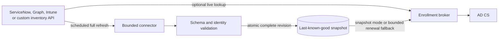

# Facts connectors

The first facts source is deliberately boring: a validated JSON snapshot on
disk. Boring is excellent at 08:59 when authentication opens at 09:00. It also
is not where most organizations keep their device truth.

An HTTP facts connector bridges those two worlds. It has two explicit modes,
because deployments have different tolerances for freshness and upstream
availability.



**Snapshot mode** queries every already catalogued device on a schedule or under
operator control, maps the responses, validates the whole candidate and then
atomically replaces the local snapshot. One bad or missing record rejects the
whole generation.

**Live mode** performs one bounded lookup during enrollment. If the upstream
system is down, a first enrollment waits and can be retried. Renewal may use the
last accepted cached record, but only while that cache is younger than the
configured maximum age. Hours may be reasonable for one deployment; months
usually are not. An expired cache fails closed.

Neither mode puts the connector, broker or inventory system in the EAP-TLS
authentication path. Once issued, the certificate carries its governed snapshot
to the relying party.

## The deliberately small language

A connector profile fixes the HTTPS origin, method and response contract. For
each device, it can put the immutable lookup identity into one of four typed
positions:

- an escaped URI path segment;
- one query-parameter value;
- one configured request-header value; or
- one JSON request-body property.

These are typed encoders, not raw URL templates. A device identifier cannot add
a query parameter, change the destination host or smuggle JSON into a request.
Redirects and decompression are disabled, and the exact HTTPS origin is checked
when the profile is loaded.

Response mappings use JSON Pointers to select scalar values for `hostname`,
`assetId`, `deviceClass`, `useCase`, `location` and `managementDomain`. The
connector requires the configured cardinality, rejects duplicate JSON
properties, enforces response-byte and JSON-depth limits, and checks that the
returned immutable identity agrees with the device it queried. A missing record,
two plausible records or one uncatalogued fact fails the operation. There is no
"take the first one" switch because the first wrong identity is still wrong.

## Authentication

The first connector contract supports static bearer tokens, Basic credentials,
fixed-header API keys, mutual TLS, and their defined mTLS combinations.
Tokens, certificates and private keys are referenced by absolute owner-only
files. They do not belong in the profile, environment, command line, logs or
repository. Server-certificate and hostname validation is always active. A
deployment can supply an explicit private trust root; it cannot request a
skip-validation mode.

OAuth 2 client credentials are a separate token-acquisition concern. Until the
connector implements native token acquisition, a reviewed secret supervisor can
materialize a short-lived access token into the bearer-token file. Do not turn a
temporary example into a long-lived Graph token and call it architecture.

## Provider starting points

Templates prefill documented API mechanics. They never decide what your
organization means by `engineering`, `kiosk`, `location` or
`managementDomain`.

Start from the committed
[Entra device profile](https://github.com/rovingclimber/adcs-enrollment-broker/blob/main/examples/facts-connector.entra-device.json)
or [ServiceNow CMDB profile](https://github.com/rovingclimber/adcs-enrollment-broker/blob/main/examples/facts-connector.servicenow-cmdb.json),
then review every identity and mapping field. The examples contain documentation
hostnames and paths and are intentionally not drop-in production configuration.

### Microsoft Entra ID through Graph

The stable lookup is the Entra device ID, not the display name:

```http
GET https://graph.microsoft.com/v1.0/devices(deviceId='{deviceId}')?$select=id,deviceId,displayName,deviceCategory,deviceOwnership,enrollmentProfileName,managementType,trustType,extensionAttributes
Authorization: Bearer {access-token}
```

Microsoft documents `deviceId` as an alternate key. Application access needs
reviewed tenant consent; `Device.Read.All` is the least-privileged application
permission for this read. `displayName` may supply the hostname, while governed
extension attributes are reasonable places for tenant-defined facts. Their
meanings are yours, not Microsoft's.

See Microsoft's [get device](https://learn.microsoft.com/en-us/graph/api/device-get?view=graph-rest-1.0),
[device resource](https://learn.microsoft.com/en-us/graph/api/resources/device?view=graph-rest-1.0)
and [app-only authentication](https://learn.microsoft.com/en-us/graph/auth-v2-service?tabs=http)
contracts when reviewing the profile and permissions.

For Intune, the supported single-record route uses the Intune managed-device ID.
Joining Intune records to an Entra device by `azureADDeviceId` is useful, but a
generic template must not promise tenant behavior that has not been tested. A
collection importer with bounded, same-origin Graph pagination is a later
increment.

### ServiceNow CMDB

A common starting point is the Table API:

```http
GET https://{instance}.service-now.com/api/now/table/cmdb_ci_computer?sysparm_query=asset_tag%3D{assetId}&sysparm_fields=sys_id,name,serial_number,asset_tag,sys_class_name,location,managed_by,owned_by,support_group,sys_updated_on&sysparm_limit=2
Accept: application/json
```

The response records are under `/result`. `sys_id` is the inherent record key;
whether asset tag, serial number or hostname is unique depends on the instance's
identification rules and data quality. Configure `exactly-one` cardinality and
make any reference-field display/value choice explicit. Custom CMDB classes and
fields are normal, which is why this is a starting profile rather than holy
scripture.

Review the current ServiceNow [Table API](https://www.servicenow.com/docs/r/api-reference/rest-apis/c_TableAPI.html)
and [CI identification rules](https://www.servicenow.com/docs/r/servicenow-platform/configuration-management-database-cmdb/t_CreateCIIdentificationRule.html)
for the target instance before choosing the lookup field.

## Operating the connector

Run snapshot sync under a dedicated identity that can read its credential files
and publish the facts authority, but cannot issue certificates or use the
signer. Schedule one run at a time. Live mode runs inside the broker and therefore
needs outbound access only to its exact configured API origin. Alert on lookup
failures and cache age in both modes.

Snapshot sync uses:

```console
PkiProxy.Api --facts-connector-sync /run/config/connector.json /run/facts/devices.json
```

The target and its directory use the same owner-only custody as manual facts
publication. The connector reads the current hash, prepares one complete next
revision and submits it to the durable publisher. The publisher retains
before/after recovery images and uses a same-directory atomic rename. Never edit
around a refused run or delete its recovery records.

For live mode, set `Broker__FactsConnectorProfileFile` alongside
`Broker__DeviceFactsFile`. The latter remains the accepted fallback/cache image.
Mapping or upstream schema changes are policy changes: a typo here can become a
durable certificate claim after the next enrollment.
