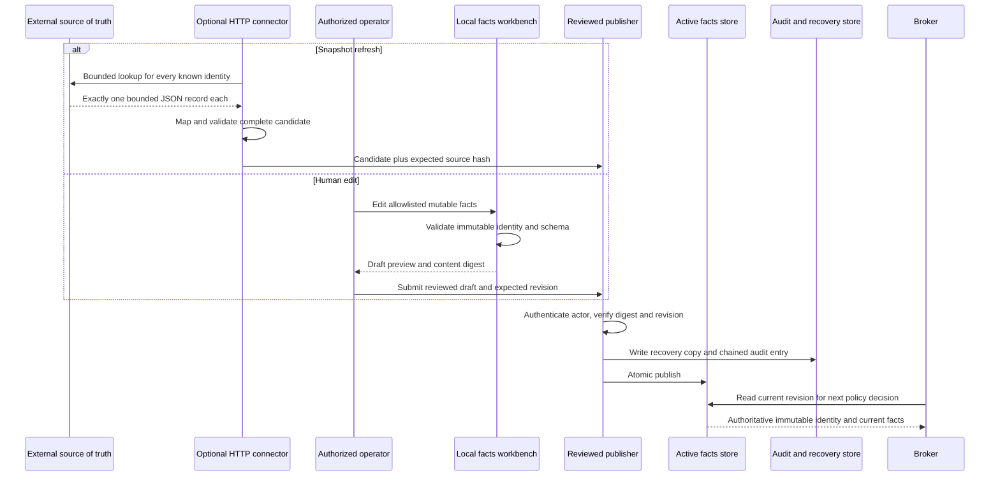

# Operational facts update flow

The workbench creates a draft; it cannot publish. Snapshot connector mode creates
a complete candidate only after every upstream record succeeds. The publisher runs under a
separate identity, accepts only allowlisted fields, protects immutable asset
identity, performs optimistic revision checks and records a hash-linked audit
entry. Facts affect the next enrollment or renewal decision; editing facts does
not rewrite an already-issued certificate.

Consequently, a facts publication does not dynamically change an active RADIUS
session or the claims presented by an installed certificate. The relying party
continues to evaluate that signed snapshot until a replacement certificate is
issued, the older certificate is revoked or expires, or separate local policy
rejects it. Deployments must align fact stability, certificate lifetime,
renewal cadence, and revocation behavior with their required response time.

Live connector mode follows a different path: initial enrollment makes one
bounded upstream lookup and fails closed when it cannot obtain current facts.
Renewal may use the last accepted local record only while its age is within the
configured maximum. No connector call occurs during an EAP-TLS authentication.

If publication fails after a recovery record is written, operators reconcile
the recorded revision and hashes before retrying. Never repair the active JSON
file by hand.

See [Facts connectors](../facts-connectors.md) for the request, mapping, cache and
provider boundaries.
