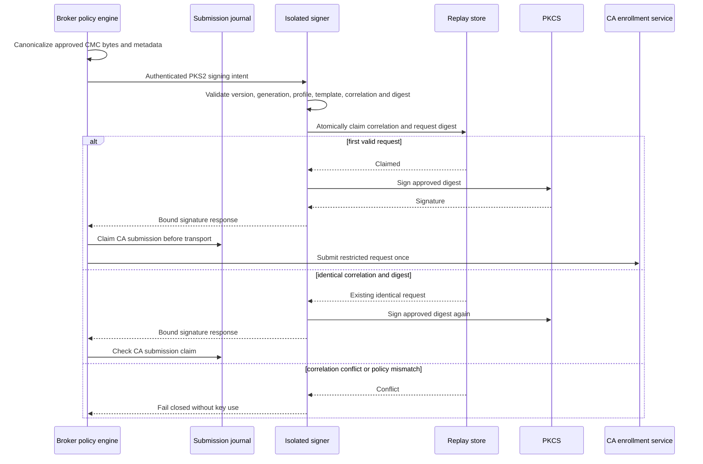

# Signer request and replay flow

The signer does not decide device identity. It independently limits how its key
can be used. Unknown configuration, legacy framing, unauthenticated peers,
generation mismatch and conflicting correlation reuse fail before signing.
The replay store retains conflict checks across a normal signer restart.

An identical retry may repeat a private-key operation. The submission journal
prevents the retry from becoming a second CA submission. Ambiguous CA outcomes
require reconciliation before any new attempt.
